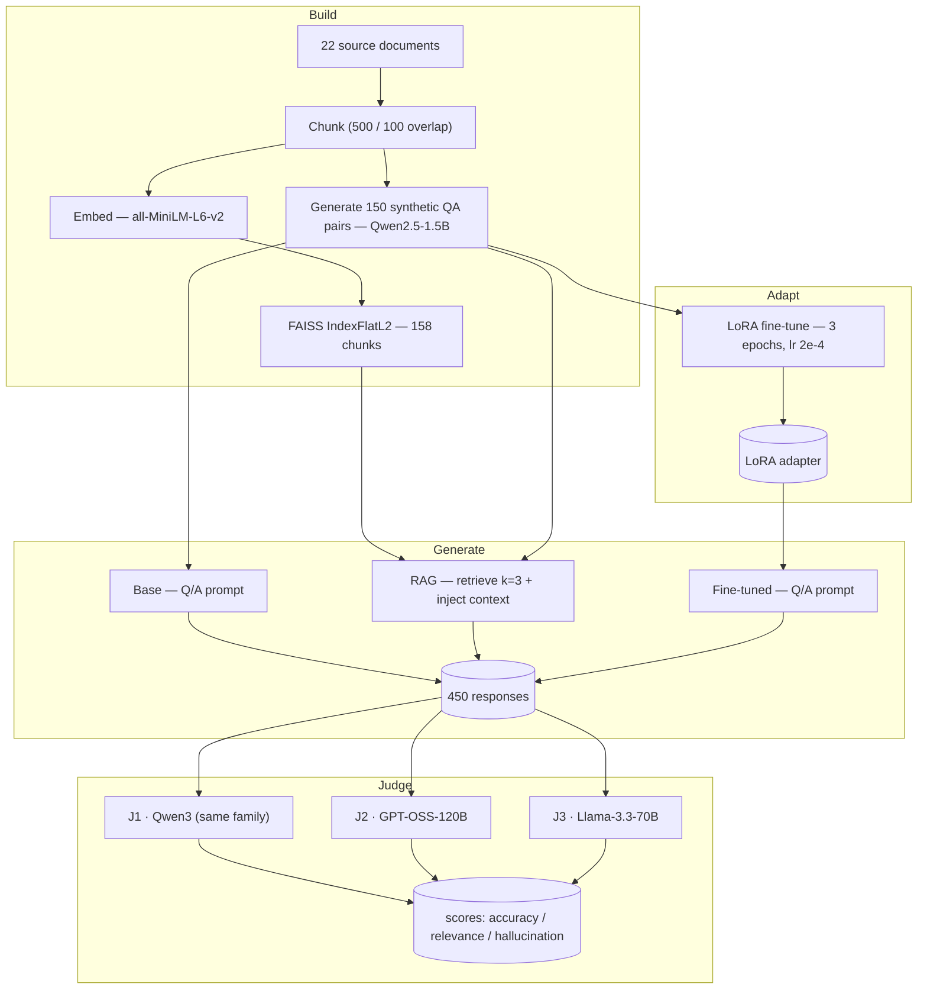

# LLM Grounding-Strategy Evaluation Pipeline

An end-to-end pipeline that builds three **grounding strategies** on top of a small
open causal LM and scores their outputs with a panel of **LLM-as-judge** evaluators.

The three strategies under test:

| Arm | How it is grounded | Implementation |
|-----|--------------------|----------------|
| **Base** | Nothing — parametric knowledge only | `Qwen2.5-1.5B-Instruct`, prompt `Q: {q}\nA:` |
| **RAG** | Retrieved context at inference time | FAISS `IndexFlatL2` over `all-MiniLM-L6-v2` embeddings, top-`k=3` chunks prepended |
| **Fine-tuned** | Parameters adapted to the domain | LoRA adapter (`r=8`, `α=16`, `q_proj`/`v_proj`) trained on the synthetic QA set |

Every response is then rated on **factual accuracy**, **relevance**, and
**hallucination** by three judges from three different model families, giving
`150 items × 3 arms × 3 judges × 3 metrics = 4,050` ratings per run.

> **Scope of this repository.** This repo contains the *generation and evaluation
> pipeline* and its produced artifacts (index, synthetic dataset, model responses,
> LoRA adapter). The downstream statistical analysis and research findings are a
> separate work-in-progress and are **held back pending publication**.

---

## Architecture



---

## Pipeline stages

| # | Script | What it does | Output |
|---|--------|--------------|--------|
| 0 | `pipeline/00_download_base_model.py` | Snapshot `Qwen2.5-1.5B-Instruct` locally so every stage shares one base | `models/base_model/` |
| 1 | `pipeline/01_build_faiss_index.py` | Chunk 22 docs (500 chars / 100 overlap), embed with `all-MiniLM-L6-v2`, build `IndexFlatL2` | `data/faiss_index.bin`, `data/faiss_chunks.json`, `data/faiss_metadata.json` |
| 2 | `pipeline/02_generate_qa.py` | Sample chunks (seed 42), prompt the base model for one Q/A each, parse + validate | `data/qa_dataset.json` (150 pairs) |
| 3 | `pipeline/03_finetune_lora.py` | LoRA fine-tune the base model on `Q: … \nA: …` strings (`r=8`, `α=16`, dropout 0.05, 3 epochs, `max_len=256`) | `models/lora_weights/` |
| 4 | `pipeline/04_generate_responses.py` | For every QA pair, generate all three arms (seeded, latency-tracked). RAG does live FAISS retrieval + context injection | `data/responses.json` (450) |
| 5 | `pipeline/05_judge{1,2,3}_*.py` | Score each response on 3 metrics via 3 separate Groq calls, with backoff, rate-limit budgeting, and strict digit/`yes-no` parsing | `data/scores_judge*.json` |

### The judge panel

| Judge | Model | Family | Decoding |
|-------|-------|--------|----------|
| J1 | `qwen/qwen3.6-27b` | Qwen — **same family as the generator** | `temperature=0`, `reasoning_effort="none"`, `max_tokens=5` |
| J2 | `openai/gpt-oss-120b` | OpenAI OSS | `temperature=0`, `reasoning_effort="low"`, `max_tokens=256` |
| J3 | `llama-3.3-70b-versatile` | Meta Llama | `temperature=0`, `max_tokens=5` |

All three judges use **byte-identical rubric prompts**. Each metric is a
separate API call so a parse failure on one never contaminates the others.
Rate-limit handling: fixed inter-call sleep sized to the model's TPM/RPM, plus
exponential backoff that honours the `retry-after` header.

Rubrics (identical across judges):

```
Rate the factual accuracy of this response on a scale of 1 to 5:
1 = completely inaccurate … 5 = completely accurate
QUESTION: {question}
RESPONSE: {response}
Respond with ONLY the number 1, 2, 3, 4, or 5:
```
(plus a parallel 1–5 relevance rubric and a yes/no hallucination rubric)

---

## Running it

```bash
python3 -m venv venv && source venv/bin/activate
pip install -r requirements.txt
cp .env.example .env          # add your GROQ_API_KEY

python pipeline/00_download_base_model.py
python pipeline/01_build_faiss_index.py
python pipeline/02_generate_qa.py
python pipeline/03_finetune_lora.py
python pipeline/04_generate_responses.py
python pipeline/05_judge1_qwen.py
python pipeline/05_judge2_gpt_oss.py
python pipeline/05_judge3_llama.py
```

Stages 1–4 run on CPU (developed on an M1 Mac, 24 GB RAM — no GPU required).
Stage 5 needs a free [Groq](https://console.groq.com) API key.

To just inspect the produced artifacts, skip straight to `data/` — the index,
`qa_dataset.json`, `responses.json`, and the `models/lora_weights/` adapter are
all checked in.

---

## What's in `data/`

| Path | Contents |
|------|----------|
| `source_docs/` | 22 short reference texts on NLP/LLM topics — the RAG corpus |
| `faiss_index.bin` / `faiss_chunks.json` / `faiss_metadata.json` | 158-chunk retrieval index (384-dim) |
| `qa_dataset.json` | 150 synthetic question/answer pairs with source-chunk provenance |
| `responses.json` | 450 model responses (base / RAG / fine-tuned) with per-arm latency |
| `models/lora_weights/` | Trained LoRA adapter — `adapter_config.json` + `adapter_model.safetensors` (~4 MB) |

The tokenizer is inherited from the base model at load time. Judge score files,
training checkpoints, and the base-model snapshot are git-ignored (all regenerated
by the pipeline).

---

## Design notes

- **Deterministic where it matters.** Chunk iteration order is pinned, QA sampling
  and response generation are seeded (42), judges run at `temperature=0`.
- **Reproducible base.** Stage 0 saves a local model snapshot so fine-tuning and
  all three generation arms load exactly the same weights.
- **Judge robustness.** Constrained decoding (`max_tokens` tuned per model to the
  measured reasoning-token budget), regex extraction of the final `[1-5]` / `yes|no`
  token, explicit `None` on unparseable output rather than a silent default.
- **Cost-aware.** Each judge script pre-computes its RPD budget against the Groq
  free-tier limits before starting and paces calls to stay inside them.
